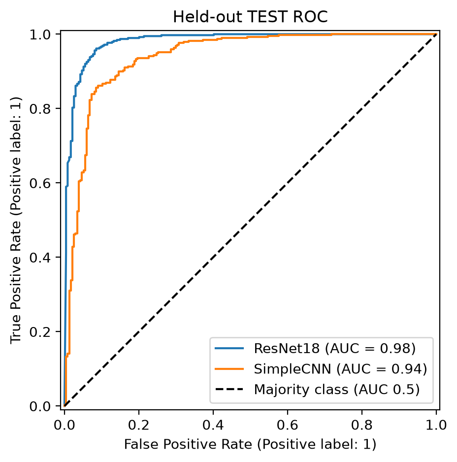
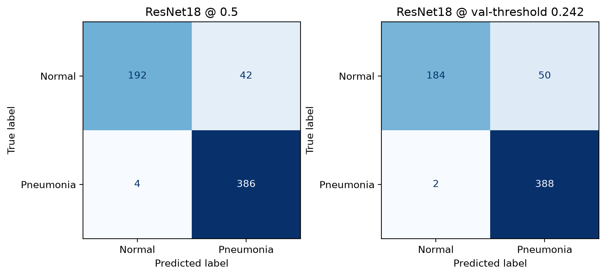
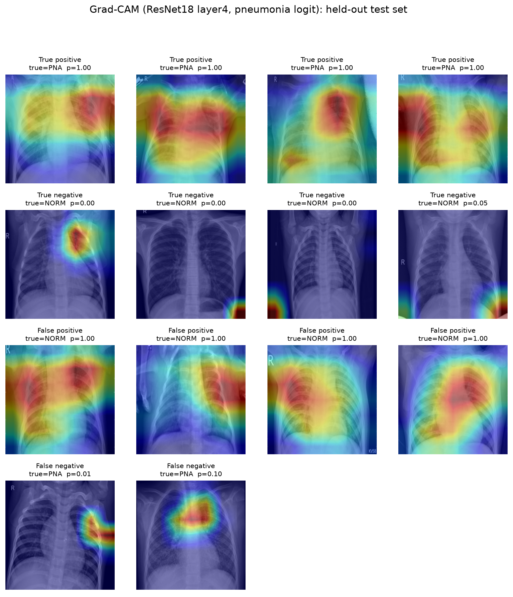

# ChestScope: Automated Chest X-Ray Classifier with Explainable AI

**Shraaptesh Lokanda** | KTP Engineering-track capstone (Biomedical Engineering / Computational)

> **Triage-support research prototype. Not a diagnostic device.** No clinical claims are made.

## Problem
Radiologist shortages and high imaging volumes cause diagnostic delays and missed findings, especially for common
conditions like pneumonia. ChestScope flags likely pneumonia on chest X-rays with a confidence score and (Week 3) a
Grad-CAM heatmap showing what the model is looking at, to support, not replace, clinical judgment.

## Setup
```bash
python3 -m venv .venv && source .venv/bin/activate
pip install -r requirements.txt
kaggle datasets download -d paultimothymooney/chest-xray-pneumonia -p data/raw --unzip
python -m src.make_splits          # leakage audit + patient-grouped splits -> data/splits/
python -m src.run_checkpoint2      # baseline + ResNet18 experiments (validation only)
python -m src.make_diagrams        # pipeline / architecture diagrams -> docs/diagrams/
```
`data/` is not committed; the splits regenerate deterministically (seed 42).

## Data
Kaggle "Chest X-Ray Images (Pneumonia)" (pediatric, single institution).
| Split | Images | % pneumonia | Patient groups |
|---|---|---|---|
| train | 4185 | 74.2 | 2120 |
| val | 1047 | 74.2 | 530 |
| test | 624 | 62.5 | 404 |

Leakage audit (official splits): 264 patient-ID groups appear in both the official train and test folders (possible overlap or ID collisions). Train/val overlap after the patient-grouped re-split: 0. pos_weight = 0.347.

- Official `val` has only 16 images, so train+val were pooled and re-split **grouped by patient** (StratifiedGroupKFold).
- The official `test` set is held out and untouched until Week 3.
- Integrity assertions: no patient or image overlap between train and val.

## Methods (through Checkpoint 2)
- **Preprocessing:** grayscale to 3 channels, resize 224x224, ImageNet normalization.
- **Augmentation (train only):** random resized crop, rotation +/-10 deg, brightness/contrast jitter. No flips (anatomical laterality).
- **Class imbalance:** weighted BCE (`pos_weight` = n_neg / n_pos from the train split); accuracy is not used as the headline metric.
- **Baselines:** majority-class dummy; SimpleCNN (4 conv blocks, from scratch).
- **Model:** ImageNet-pretrained ResNet18, two-phase fine-tuning (frozen backbone, then full fine-tune with lower backbone lr). Best checkpoint chosen by validation ROC-AUC.
- Diagrams: `docs/diagrams/pipeline.png`, `architecture.png`, `baseline_architecture.png`.

## Results 
| Model | auc | recall | specificity | precision | f1 | accuracy |
|---|---|---|---|---|---|---|
| Majority-class dummy | 0.500 | 1.000 | 0.000 | 0.742 | 0.852 | 0.742 |
| SimpleCNN (scratch) | 0.988 | 0.732 | 0.989 | 0.995 | 0.844 | 0.798 |
| ResNet18 (fine-tuned) | 0.998 | 0.969 | 0.996 | 0.999 | 0.984 | 0.976 |


## Test-set results (held-out; evaluated once)
Decision threshold for ResNet18 = 0.242, chosen on the **validation** set to reach 95% recall.
Values are point estimate [95% bootstrap CI, 1,000 resamples].

| model | auc | pr_auc | recall | specificity | precision | f1 | balanced_accuracy |
|---|---|---|---|---|---|---|---|
| Majority-class dummy | 0.500 [0.500, 0.500] | 0.625 [0.588, 0.663] | 1.000 [1.000, 1.000] | 0.000 [0.000, 0.000] | 0.625 [0.588, 0.663] | 0.769 [0.741, 0.798] | 0.500 [0.500, 0.500] |
| SimpleCNN @0.5 | 0.939 [0.917, 0.959] | 0.945 [0.914, 0.972] | 0.810 [0.770, 0.849] | 0.932 [0.896, 0.961] | 0.952 [0.925, 0.973] | 0.875 [0.848, 0.899] | 0.871 [0.844, 0.895] |
| SimpleCNN @val-threshold (0.038) | 0.939 [0.917, 0.959] | 0.945 [0.914, 0.972] | 0.990 [0.980, 0.998] | 0.560 [0.498, 0.625] | 0.789 [0.756, 0.827] | 0.878 [0.856, 0.902] | 0.775 [0.746, 0.808] |
| ResNet18 @0.5 | 0.981 [0.971, 0.990] | 0.986 [0.974, 0.994] | 0.990 [0.978, 0.998] | 0.821 [0.771, 0.868] | 0.902 [0.875, 0.931] | 0.944 [0.928, 0.960] | 0.905 [0.880, 0.929] |
| ResNet18 @val-threshold (0.242) | 0.981 [0.971, 0.990] | 0.986 [0.974, 0.994] | 0.995 [0.987, 1.000] | 0.786 [0.732, 0.837] | 0.886 [0.858, 0.917] | 0.937 [0.921, 0.954] | 0.891 [0.862, 0.917] |

**Statistical comparison against the baseline.** Paired bootstrap AUC difference (ResNet18 minus SimpleCNN): +0.042 (95% CI +0.027 to +0.062, p = 0.001). McNemar exact test at each model's validation-chosen threshold: only ResNet18 correct = 62, only SimpleCNN correct = 7, p = 4.1e-12.




### Hyperparameter comparison (validation set)
| config | lr_backbone | unfreeze | val_auc | val_recall | val_specificity | val_f1 | val_loss |
|---|---|---|---|---|---|---|---|
| base | 0.0001 | all | 0.9982 | 0.9691 | 0.9963 | 0.9837 | 0.0299 |
| lr3e-4 | 0.0003 | all | 0.9984 | 0.9408 | 1.0 | 0.9695 | 0.049 |
| layer34 | 0.0001 | layer34 | 0.9981 | 0.9562 | 0.9926 | 0.9763 | 0.0329 |

### Seed variability of the selected configuration (validation set)
| seed | val_auc | val_recall | val_specificity | val_f1 |
|---|---|---|---|---|
| 42 | 0.9982 | 0.9691 | 0.9963 | 0.9837 |
| 1 | 0.998 | 0.9434 | 1.0 | 0.9709 |
| 2 | 0.9984 | 0.9807 | 0.9963 | 0.9896 |
| mean | 0.9982 | 0.9644 | 0.9975 | 0.9814 |
| std | 0.0002 | 0.0191 | 0.0021 | 0.0096 |

## Explainability (Grad-CAM)


Share of Grad-CAM heat falling on the outer image border (possible shortcut indicator), by outcome group:

| group | count | mean | std |
|---|---|---|---|
| FN | 2 | 0.285 | 0.281 |
| FP | 50 | 0.375 | 0.09 |
| TN | 60 | 0.677 | 0.289 |
| TP | 60 | 0.372 | 0.043 |

## Demo
```bash
pip install streamlit
streamlit run app.py        # upload an X-ray: prediction, confidence, Grad-CAM overlay
python -m src.predict path/to/xray.jpeg
```
Model weights (`results/checkpoints/final.pt`) are not committed; https://github.com/shraapteshlokanda-coder/chestscope

## Limitations
- Pediatric, single-center data; may not generalize to adults or other scanners.
- Official train and test distributions differ (class balance), so test performance may be lower than validation.
- Possible shortcut features (intensity or image-size differences between classes); see EDA notebook.
- Labels are not independently verified. Research prototype only.

## Future Work
Hyperparameter tuning, first held-out test evaluation, Grad-CAM overlays and error analysis, optional Streamlit upload demo.
